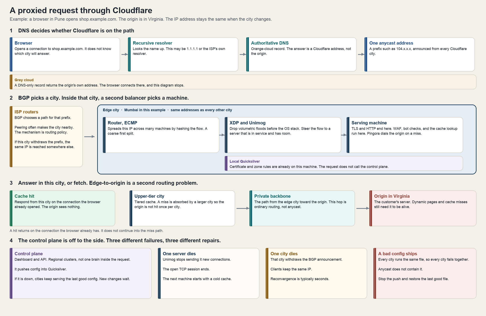

# How Cloudflare carries a request

Cloudflare sits in front of a large share of the public web, spread across thousands of servers in 330+ cities, and it is built to keep answering when machines and cities disappear. The interesting part is not a single trick. A request is admitted by one distributed system, answered by a second, and configured by a third. They fail in different ways, and they are repaired in different ways.

This note is the map: the words, the path one request takes, what actually removes a single point of failure, and the design judgments worth practicing.

## The model

Cloudflare, for a proxied website, is a reverse proxy. The browser talks to Cloudflare. Cloudflare talks to the customer's server, the **origin**, only when it has to.

Three outcomes follow from that:

- A **cache hit** is answered in the city the user reached. The origin sees nothing.
- A **cache miss**, or a page that cannot be cached, is fetched from the origin and maybe stored.
- **Attack traffic** is dropped at the edge, so the origin never has to be large enough to survive it.

Cloudflare hides the origin for the requests it can answer or reject. The origin is still the source of truth for everything else. A single database in one region is still a single database in one region.

There is a second split, and it explains the outages better than the traffic numbers do.

- The **data plane** is the servers in those cities. They accept packets, apply policy, and return responses. A request does not call home.
- The **control plane** is the dashboard, the API, and the source of truth for configuration. Cloudflare runs it as regional clusters, replicated to another region. It does not forward customer traffic.

Configuration reaches the edge through **Quicksilver**, a key-value store copied onto the machines that serve traffic. A server reads policy from its local copy. That read is local, on the order of microseconds. If the control plane is down, the edge keeps serving the last good config. Customers wait to change settings.

A flood and a bad config therefore fail differently. A flood arrives in many cities, and each city filters its share. A bad config is copied onto every machine, so every city fails together.

## Definitions

### Addressing and routing

**Unicast.** One IP address means one destination. If every client is sent to that one machine, the machine is the bottleneck and the failure domain.

**Anycast.** The same IP prefix is announced from many places at once. Routers deliver a packet to whichever announcement their routing table prefers. The client does not choose the city, and it does not learn a new IP when the city changes. Failover is "stop announcing from the dead city."

**BGP (Border Gateway Protocol).** The protocol networks use to tell each other which prefixes they can reach. Anycast is a BGP behavior: many Cloudflare cities advertise the same prefix. When Mumbai withdraws it, other networks send that prefix to the next-best announcement they still have.

"Closest" is the usual result, because networks peer near their users. The mechanism is routing policy: local preference, path length, and business relationships. A user can land in a farther city when their ISP's routes say so.

**ECMP (equal-cost multi-path).** A router has several equally good next hops and spreads flows across them, hashing the connection so one flow stays on one path. Inside a Cloudflare city, ECMP is the coarse first split of an anycast IP across many machines. It is a poor tool for draining one sick machine cleanly. A second balancer does that job.

### Inside a city

**XDP (eXpress Data Path).** A Linux hook that runs a small program on a packet as the network card hands it over, before the normal stack allocates a socket. A cheap place to throw packets away, and a cheap place to redirect them.

**Unimog.** Cloudflare's layer-4 load balancer, running in that early path. It sends a connection to a server that is in service and has room. Health checks and maintenance remove a server from the pool. New connections move. An already-open connection does not follow the dead process.

**TLS termination.** The encrypted session ends on Cloudflare's machine, which holds the certificate (or can complete the handshake). After that, the proxy can see the HTTP host, path, headers, and body. Caching and firewall rules need that view. It also means Cloudflare is on the trust path for the request.

**Keyless SSL.** For customers that will not hand over a private key, the edge asks a key server the customer runs to perform the private-key operation. The key stays in the customer's infrastructure. The edge still sees the HTTP once the session exists.

**Pingora.** The Rust proxy Cloudflare built to connect the edge to origins and to the rest of the internet, replacing nginx in that role. When they introduced it, they reported on the order of a trillion requests a day at about a third of the CPU and memory of the proxy it replaced. Product logic on the request (firewall, bots, cache) and the outbound connection live on this part of the path. A request inside one city can cross more than one machine: the router lands on one, Unimog redirects to another, and the serving machine does the HTTP work.

**Quicksilver.** The configuration database. The control plane writes it. Edge machines keep a replica and serve from that replica. Certificates, firewall rules, and zone settings are already local when the handshake starts.

### Cache, origin, and the path between them

**Orange cloud.** A proxied DNS record. Authoritative DNS returns a Cloudflare anycast address. The browser's TCP connection ends at Cloudflare.

**Grey cloud.** A DNS-only record. Authoritative DNS returns the origin's address. Cloudflare is not on the connection. None of the rest of this note applies to that record.

**Origin.** The customer's server. The only place that can compute a response the edge does not already have.

**Cache hit.** A stored response is still valid for this request. The city answers from local memory or disk.

**Cache miss.** The city does not have a usable response and must fetch one.

**Tiered cache.** A smaller city asks a larger, upper-tier city before it asks the origin. One cold object then costs about one origin fetch per region, rather than one fetch per city.

**Backbone.** Cloudflare's own long-haul network between cities. The user-to-edge hop is anycast. The edge-to-origin hop is a separate routing choice, and it can ride this backbone when that path is better than the public internet.

### Compute and state

**V8 isolate.** The sandbox for customer code on Workers. Many isolates share one process. Each has its own memory. Starting one is far cheaper than starting a virtual machine, in both time and RAM. This isolates customer code. It does not give each website its own copy of the proxy.

**Durable Object.** One named object, with its own storage, in one place, processing that object's requests on a single thread. Clients all over the world enter through anycast, and Cloudflare then routes those requests to the object. Strong ordering for that key is bought by giving up "any machine will do."

**Workers KV.** A key-value store with central writes and edge caches. A value is cached in a city after something there reads it. Other cities can keep serving the previous value for a while, often around a minute. Fast local reads are the point. Ordered updates are a different product.

## One request, end to end

A user in Pune opens `shop.example.com`. The origin is in Virginia. The diagram is the same path the rest of this section walks.

1. **DNS decides whether Cloudflare is on the path.** The browser asks a recursive resolver (often 1.1.1.1 or the ISP). The resolver asks the authoritative DNS for the zone. An orange-cloud record answers with a Cloudflare address such as `104.x.x.x`. That same prefix is announced from every city. A grey-cloud record answers with the origin address, the browser connects there, and Cloudflare never sees the request.

2. **BGP picks the city.** The user's ISP forwards packets for that prefix toward whichever Cloudflare announcement its routes prefer. Peering often makes that Mumbai. It can be a farther city. The browser still has one IP.

3. **Inside the city, a second balancer picks the machine.** The router uses ECMP to spread the IP across many servers. On those servers, XDP drops obvious volumetric floods, and Unimog steers the flow to a machine that is healthy and has capacity. That machine terminates TLS and HTTP. It can do this because the certificate and the zone's rules are already on disk in the local Quicksilver replica.

4. **Policy, then the cache.** Firewall rules, bot checks, and the cache lookup are local decisions. On a hit, the response goes back on the connection the browser already opened. Virginia is never contacted.

5. **A miss is a different routing problem.** The user-to-edge hop was anycast. The edge-to-origin hop is not. A small city often asks an upper-tier city first. That city fetches Virginia, sometimes over Cloudflare's backbone, stores the object, and returns it. The next user in Mumbai is then a hit. Tiered cache exists so thousands of cities do not miss at the same moment and stampede the origin.

If that one Mumbai server dies, the browser's retry is a new connection, and Unimog sends it to another Mumbai server. The new server does not inherit the TLS session or the cache. If the whole city loses power, Mumbai withdraws the anycast announcement and BGP sends later packets to the next-best city. DNS does not change. The IP does not change. Internet-wide reconvergence is typically seconds. Connections that were open in the dead city break. New ones succeed.

## What removes the single point of failure

### 1. Anycast is the admission layer

In the unicast setup, one address belongs to one place, and every client that has that address is aimed at that place. Cloudflare announces one prefix from hundreds of cities. The internet's own routers fan the traffic in. A volumetric flood is split the same way users are split: each city sees a share, and that share can be filtered there.

The client keeps using the same address the whole time. There is no "switch to the backup IP" step for the browser to get wrong, and there is no DNS TTL to wait out.

### 2. The request path is shared-nothing

Any server in any city can handle any proxied customer, because every server runs the same software and already has the config. That is why a neighbor can take the next connection. There is no master that has to approve the request.

The neighbor takes the next connection only. The TCP session on the dead process ends. The cache on the dead process stays there. Uniformity is also why a bad release fails everywhere at once: the machines are interchangeable, so their bugs are correlated. Quicksilver, logs, and the control plane are shared state in the company. The request path does not wait on them.

### 3. Capacity is headroom, and the drop path matters as much as the ports

As of Cloudflare's April 2026 write-up, the network had crossed **500 Tbps of provisioned external interconnection capacity**: the sum of ports facing transit providers, private peers, internet exchanges, and private interconnects, across 330+ cities. That number is not the traffic of a normal day. Peak use is a fraction of it. The rest is the budget for a bad day.

Spare ports absorb volume. They do not, by themselves, distinguish a user from a flood that looks like users. Volumetric layer-3 and layer-4 attacks are dropped in XDP, before they become socket and HTTP work. Application-layer floods need the HTTP view: bot scores, challenges, rate limits. That second kind of defense is software on the shared proxy, which is why a bug in it can become an outage (see below).

### 4. Isolation is real for customer code, and limited for the proxy

Workers run customer code in V8 isolates: separate memory, a CPU budget, a fast start, many tenants in one process. A tenant's script can be evicted without booting a virtual machine per request.

A normal proxied site does not get its own machine. Rate limits and bot scores contain a noisy customer. The proxy, the cache, and the packet path are shared software. A bug there crosses tenants. Isolation is a set of budgets and sandboxes on top of a shared fleet, not a private server per website.

### 5. Three repairs, not one "self-healing" switch

| What broke | What repairs it | What the user feels |
| --- | --- | --- |
| One server | Unimog stops handing it new connections | The open request fails. A retry lands on a live server in the same city, with a cold cache. |
| One city | BGP withdrawal of that city's announcement | Later packets for the same IP reach another city. This is seconds, not a new DNS lookup. Open connections in the dead city die. |
| A bad config or binary, shipped everywhere | Stop the push. Restore the last good version in Quicksilver. | This is the outage that takes many cities down together. Anycast does not help, because every city is running the bad file. |

## When the whole network fails

Widespread Cloudflare outages have a repeating shape: the data plane is doing what the control plane told every machine to do.

On **2 July 2019**, a WAF managed rule containing a regular expression with catastrophic backtracking was deployed globally. CPU on the HTTP path pegged in every city. Customers saw 502s for about 27 minutes. The ability to push a rule everywhere in seconds, which is the feature, was also the blast radius.

On **18 November 2025**, a permissions change on a database caused a Bot Management feature file to grow past a limit the proxy software enforced. The oversized file had already been propagated. The first reading of the symptoms was a large DDoS. It was not a capacity failure. Core traffic came back after the bad file was stopped and an earlier file restored. Recovery then had a second chapter, as load returned.

The design lesson is the homogeneous fleet. Interchangeable machines are how anycast and "any server can take the next request" work. They are also how one file becomes a global outage. The safeguards that match that choice are canary cities, a budget a single rule cannot exceed, automatic rollback on error or CPU, and a data plane that keeps the previous file if the new one will not load.

## Where state is allowed to live

Anycast works because a replaceable HTTP request has no memory the next machine must inherit. The design gets interesting where that stops.

| State | Where it lives | What a failure or a retry does |
| --- | --- | --- |
| Cacheable HTTP response | The machine, then the city, then an upper tier | Another machine or city can answer. A neighbor is cold and may miss. |
| TLS session and TCP connection | That one process | The connection ends. The client opens a new one. |
| Zone config and certificates | Quicksilver, on every machine | Every machine makes the same decision without calling home. A bad write is on every machine too. |
| Workers KV | Written centrally, then cached at the edge | Another city can serve an older value for a short time. |
| Durable Object | One object, one thread, one location | Every update for that key is ordered. Distant users pay a hop to wherever the object lives. That place is the failure domain for that key. |
| Dynamic page, uncached | The origin | The edge cannot invent the answer. |

Durable Objects are the pattern to sit with. A counter, a chat room, or a lock wants a single owner. Cloudflare's answer is an actor: a globally unique name, storage next to the code, requests for that name lined up on one thread. Users still arrive at whatever city BGP chose, and from there the platform routes to the object. KV is the other classic choice: read locally, accept lag.

The platform is a menu of consistency models. Stateless at the edge when the answer is replaceable. Pin the state when the updates must be ordered. Replicate the config everywhere when every machine must decide the same way.

Two consequences are easy to miss:

- **Decrypting at the edge is the product.** The firewall and the cache have to see HTTP, so TLS ends on Cloudflare's machines unless a keyless setup is doing the private-key step elsewhere. Using the proxy is a decision to put Cloudflare in the trust path.
- **Hiding the origin is not the same as replacing it.** Proxied DNS stops publishing the origin address. Cloudflare Tunnel goes further: the origin dials out, so it need not listen on a public port. Cache misses and dynamic requests still need that origin to be up.

## System design insights

These are the judgments worth being able to say out loud in a design discussion.

1. **Keep the control plane off the request path.** The hot path reads a local replica. A control-plane outage then freezes changes and leaves serving alone. The hard part moves to propagation: how fast a good change arrives, and how a bad change is stopped.

2. **A homogeneous fleet is a trade, not a default virtue.** Any machine answering any customer is what makes draining a server and losing a city cheap. It also makes failure correlated. Budget for canaries and automatic rollback in the same design where you budget for anycast.

3. **Anycast moves admission, not memory.** Say explicitly which state a retry is allowed to lose (a TCP connection, a cold cache) and which state has an owner (a Durable Object, a database row, a certificate that must match on every machine).

4. **There are two routing problems.** User to edge: BGP and anycast, optimized by being in many cities and peering locally. Edge to origin: backbone, tiered cache, and timeout budgets. Making the first hop short does not make the origin fetch short.

5. **ECMP is a coarse split, and draining one machine needs a real balancer.** Hashing flows across equal paths spreads load. Removing one machine reshuffles that hash or leaves a hole. Unimog is the membership-aware layer in front of the serving machines. The paper that teaches the technique is Google's Maglev: hash the connection so one backend can leave and only its flows move.

6. **Drop cheap packets before they become expensive work.** Spare bandwidth absorbs volume. XDP exists so attack packets die before TLS, HTTP, and application code. Separately, decide what you will do with traffic that is expensive because it looks legitimate.

7. **Publish capacity as headroom.** A 500 Tbps interconnection number is the size of the ports, and most of it is unused on a normal day on purpose. Design reviews should ask what the drop path does when the ports fill, not only what the number is.

8. **Pick a consistency model per key, not per company.** Local cache: disposable and allowed to be stale. Replicated config: every replica should match, so the propagation mechanism is the risky part. KV: stale reads, local answers. Single-threaded owner: ordered updates, one failure domain, extra latency for everyone who is far from it.

9. **The origin is the customer's single point of failure for anything uncached.** Health checks, multiple origins, and an outbound tunnel change how the origin is reached. They do not create a second copy of a write that only one database accepted.

10. **Name the repair with the failure.** Draining a server, withdrawing a prefix, and rolling back a file are different mechanisms with different clocks. A design that says "it failovers" without saying which of the three is unfinished.

## Practice

Work these on paper or a whiteboard. A strong answer names the state, the failure domain, and the repair. It also names what gets worse because of the choice.

### 1. A global reverse proxy

Design a service that terminates TLS for a large number of customer domains, caches static responses near users, and proxies the rest to origins that live in one region. Any one city can go dark. Already-configured sites must keep serving if the configuration API is down.

Include: how a client finds you, what is stored on each machine before the request arrives, the cache key (host, path, and which headers change the response), how a miss is prevented from fanning out to one origin request per city, and what happens to in-flight requests when a city withdraws its route.

### 2. Shipping a rule to every city

You can push a firewall rule worldwide in seconds. A bad rule can peg CPU everywhere, as on 2 July 2019.

Include: a canary scope, a CPU and error signal that triggers rollback, a limit on what one rule is allowed to cost, and why "we will notice and revert" is a weaker answer than a loader that refuses a file it cannot apply.

### 3. A like counter

Users in many countries increment one counter. Increments must not be lost and must have an order. A copy of the counter in each city's cache will diverge.

Include: a single owner for that key, how a request that arrived in Mumbai reaches the owner, what latency distant users pay, and what you do when the owner's machine dies (the object has to come back somewhere, and in-flight increments need a story).

### 4. The control plane is down for an hour

The API that edits DNS and firewall rules is unavailable. Sites that were already proxied should keep working.

Include: where the serving machines read policy, what is frozen, and certificates that would expire during the hour. The last point is the one people forget.

### 5. DNS failover versus anycast

Compare two designs for "if Virginia is down, send users to Dublin." Design A changes an A record after a health check. Design B withdraws an anycast announcement.

Include: resolver caches and TTL, what the client must learn, how long each failover takes, and what happens to a websocket that was open at the moment of the failure.

### 6. The stampede after a purge

You purge one popular object. Ten thousand cities miss at once.

Include: coalescing identical misses inside one city (single-flight), an upper tier or origin shield, stale-while-revalidate if a slightly old object is acceptable, and the inconsistency window you are willing to show after a purge.

## Reading

Read in this order. The postmortems come after the architecture, so the question to ask is: which machines were supposed to be independent, and why did they fail together?

**The path**

- [Anycast, in Cloudflare's learning center](https://www.cloudflare.com/learning/cdn/glossary/anycast-network/) — the short definition.
- [Cloudflare architecture and how BPF eats the world](https://blog.cloudflare.com/cloudflare-architecture-and-how-bpf-eats-the-world/) — ECMP, XDP, and why a request crosses several machines inside one city.
- [Unimog, the edge load balancer](https://blog.cloudflare.com/unimog-cloudflares-edge-load-balancer/) — draining a server without pretending ECMP is enough.
- [Introducing Quicksilver](https://blog.cloudflare.com/introducing-quicksilver-configuration-distribution-at-internet-scale/) — config as a distributed system, and why the request path only reads.
- [How we built Pingora](https://blog.cloudflare.com/how-we-built-pingora-the-proxy-that-connects-cloudflare-to-the-internet/) — the proxy that connects the edge to origins.
- [500 Tbps of capacity](https://blog.cloudflare.com/500-tbps-of-capacity/) — what the capacity number counts, and what it leaves unused on purpose.
- [Tiered cache](https://developers.cloudflare.com/cache/how-to/tiered-cache/) — the shield in front of the origin.

**The failures**

- [The outage on 2 July 2019](https://blog.cloudflare.com/details-of-the-cloudflare-outage-on-july-2-2019/) — one regular expression, every city.
- [The outage on 18 November 2025](https://blog.cloudflare.com/18-november-2025-outage/) — a feature file, propagated, past a limit in the software. First mistaken for an attack.

**State, after the stateless path makes sense**

- [How Workers works](https://developers.cloudflare.com/workers/reference/how-workers-works/) — isolates, and what they isolate.
- [Durable Objects: easy, fast, correct](https://blog.cloudflare.com/durable-objects-easy-fast-correct-choose-three/) — why a single thread plus colocated storage avoids a class of races.
- [What Durable Objects are](https://developers.cloudflare.com/durable-objects/concepts/what-are-durable-objects/) — the product rules: one name, one place, ordered requests.
- [How KV works](https://developers.cloudflare.com/kv/concepts/how-kv-works/) — the eventual-consistency end of the same menu.
- [Going keyless everywhere](https://blog.cloudflare.com/going-keyless-everywhere/) — private keys, and the trust boundary TLS termination creates.

**The papers and the book behind the patterns**

- [Maglev: A Fast and Reliable Software Network Load Balancer (NSDI 2016)](https://www.usenix.org/system/files/conference/nsdi16/nsdi16-paper-eisenbud.pdf) — consistent hashing of a connection so one backend can leave and only its flows move. Unimog is Cloudflare's balancer in this tradition; Maglev is the paper to study.
- [Amazon's Dynamo (SOSP 2007)](https://www.allthingsdistributed.com/files/amazon-dynamo-sosp2007.pdf) — eventual consistency, and why a system would rather answer locally than wait for a quorum. Read it next to KV.
- Martin Kleppmann, *Designing Data-Intensive Applications* — the replication, partitioning, and consistency chapters. The table in this note is that material, with Cloudflare's product names on the rows.

After those, redo practice problem 3 and practice problem 5 without looking at this note. If the like-counter answer still starts with "put it in every city and reconcile later," the Durable Object section has not landed yet. If the DNS-failover answer never mentions TTL, the anycast section has not landed yet.
